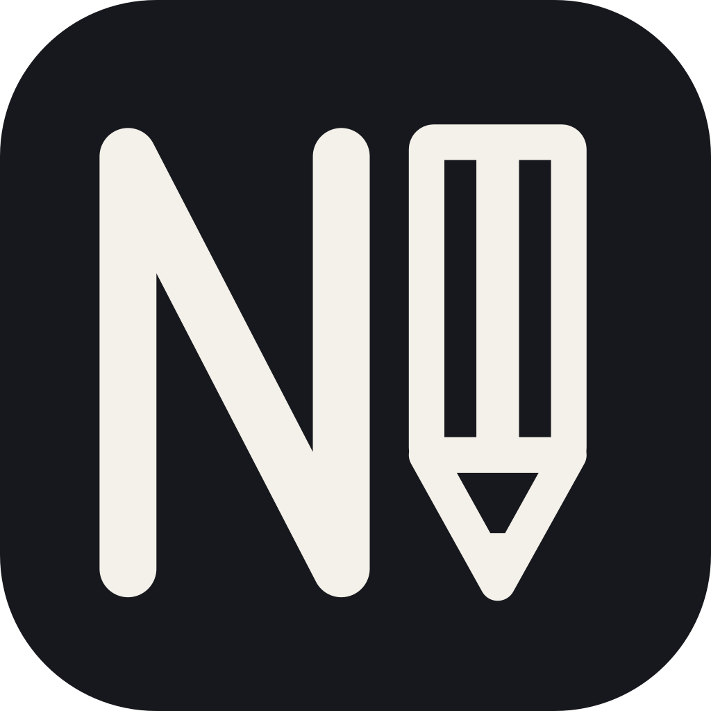

# Notedown



**Speak instead of typing on Android.**

Notedown turns your voice into text. Tap a floating microphone while typing in another app, speak, then stop—the transcription is inserted into the text field you're using.

You can also record inside Notedown and copy the result later. No Notedown account or subscription is required.

## Download

**[Download the latest APK](https://github.com/fadilf/notedown/releases/latest)** from the release's **Assets** section. On your phone, open the APK and allow installation from your browser or file manager when Android asks.

APKs appear here after the first automated release. If no release is available yet, you can [build the app yourself](#development).

## What it does

- Dictate into text fields in other apps.
- Keep recordings and transcripts so you can listen, copy, or transcribe again.
- Choose a transcription model through OpenRouter.
- Optionally clean up the transcript with a separate AI model.
- View API-reported spending in the usage screen.

## What you need

- Android 10 or newer.
- An [OpenRouter](https://openrouter.ai/) API key with credits. Transcription and optional cleanup use your OpenRouter balance.
- Microphone permission. Dictating into other apps also requires enabling Notedown's accessibility service.

## Get started

1. Install and open Notedown.
2. In **Settings**, enter your OpenRouter API key and validate/save it.
3. Refresh the model list and choose a transcription model.
4. Allow microphone access.
5. To dictate into other apps, enable **Notedown dictation** in Android's accessibility settings.

Notification permission is optional; it makes recording controls easier to access.

## Use it

1. Open a text field in another app so the keyboard appears.
2. Tap the floating microphone and speak.
3. Tap **Stop** to save the audio and transcribe it. The result is inserted into the currently focused text field, replacing any selected text.

Drag the microphone to reposition it. Tap **Cancel** to discard a recording without sending it for transcription.

You can also use **Dictate** inside Notedown without enabling accessibility. In-app recordings and history retranscriptions do not insert text automatically. Open history to play recordings, copy text, try another model, switch transcript versions, or delete recordings.

If automatic insertion is unavailable, use **Copy**. Notedown only writes to the clipboard when you explicitly ask it to.

## Privacy and costs

Recordings and transcripts are stored privately on your phone. Audio is sent directly to OpenRouter and the selected provider for transcription. If you enable cleanup, the transcript is sent separately for that step. Provider retention policies apply.

Your API key is encrypted on the device using Android Keystore, and backups are disabled. Uninstalling Notedown deletes local history.

Requests may cost money. The usage screen shows exact API-reported costs and marks missing costs as unavailable. Deleting history does not delete the usage ledger.

## Limits and retries

- Recordings stop automatically after ten minutes. Uploads are limited to 25 MB.
- Supported audio formats and languages depend on the selected model. WAV compatibility mode is available in Settings.
- Automatic insertion requires a focused, enabled text field; password fields are excluded.
- Offline recordings wait for connectivity. Failed API requests require an explicit retry from history: even a timed-out request may already have cost money.
- Each transcription or retry creates a new version. Queued requests keep the settings they were created with. If cleanup fails, the raw transcript remains usable.
- Android force-stop pauses background work until you reopen the app. Interrupted audio is recovered when possible, but unfinished recordings may be unplayable.

## Development

Notedown is a native Kotlin app using Jetpack Compose Material 3, Hilt, Room, DataStore, Retrofit/OkHttp, Media3, and WorkManager. It has no backend. Production code is under `app/src/main/java/com/notedown/`.

Open the project in Android Studio. Use **JDK 21** and install **Android SDK 37**. Set `sdk.dir` in an untracked `local.properties` if needed. Application bytecode targets Java 17; minimum Android API is 29 and target API is 36.

```sh
./gradlew :app:assembleDebug
./gradlew :app:assembleRelease
```

The debug APK is `app/build/outputs/apk/debug/app-debug.apk`. Local release builds are optimized and unsigned unless you configure signing.

### Automated releases

A major/minor version increase on `main`, such as `1.0.2 → 1.1.0`, runs unit tests and lint, builds a signed APK, and publishes it to GitHub Releases. Ordinary pushes and patch-only bumps skip the Android build.

See **[Release setup](docs/RELEASING.md)** for the required signing secrets and versioning instructions.

### Testing

```sh
./gradlew :app:testDebugUnitTest :app:lintDebug
./gradlew :app:connectedDebugAndroidTest
python3 -B -m unittest discover -s .github/scripts -p 'test_*.py'
```

Device tests require a running emulator or device; audio tests use its microphone. Automated API tests use fakes and do not spend OpenRouter credits. The release workflow runs JVM tests and lint; device and live API checks are separate.

See **[Device verification](docs/TESTING.md)** for keyboard compatibility, physical-device checks, and live API testing.
